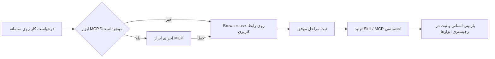

# اتصال به سامانه‌های سازمان

## وضعیت سامانه‌ها

- **برخی سامانه‌ها وب‌سرویس/API دارند** → اتصال مستقیم از طریق MCP Server.
- **برخی فقط رابط کاربری دارند (کار دستی)** → دستیار باید قابلیت **Browser-use** داشته باشد و مثل یک کاربر با مرورگر کار کند.

## یادگیری اتصال: از Browser-use به MCP اختصاصی

الگوی مورد انتظار (مشابه رفتار Hermes Agent در ساخت مهارت از تجربه):

1. دستیار بار اول کار را با Browser-use در رابط کاربری سامانه انجام می‌دهد.
2. از این تجربه، یک **مهارت (Skill)** یا **MCP Server اختصاصی** برای آن سامانه می‌سازد (مثلاً ابزار «جست‌وجوی نامه» یا «خواندن ارجاعات»).
3. از آن به بعد به‌جای مرور دستی، از MCP خودش استفاده می‌کند؛ سریع‌تر، ارزان‌تر و قابل اطمینان‌تر.
4. اگر رابط سامانه تغییر کند و ابزار خراب شود، دوباره به Browser-use برمی‌گردد و ابزار را به‌روز می‌کند.

## الزامات پیشنهادی برای پیمانکار

- **فقط خواندنی در فاز ۱:** حساب کاربری سرویس با دسترسی Read-only در هر سامانه؛ ابزارهای ساخته‌شده نباید عملیات نوشتن داشته باشند.
- **بازبینی انسانی ابزارهای خودساخته** پیش از فعال شدن در محیط عملیاتی.
- **رجیستری ابزارها** با نسخه‌بندی، لاگ استفاده و امکان غیرفعال‌سازی.
- **نگهداری امن اعتبارنامه‌ها** (Vault) و عدم ذخیره رمز در Prompt یا مهارت.
- **ثبت ممیزی (Audit log)** برای هر دسترسی دستیار به سامانه‌ها.

## یافته‌های تحقیق

- Hermes Agent کلاینت MCP دارد، ابزار مرورگر (`browser_exec` با Chromium محلی یا CDP) دارد، و سیستم Skills با نگهداری پس‌زمینه (Curator) برای مهارت‌های خودساخته دارد. منبع: [Hermes docs](https://hermes-agent.nousresearch.com/docs/llms.txt)
- کتابخانه متن‌باز [browser-use](https://github.com/browser-use/browser-use) و MCP Serverهای مرورگر (مثل Playwright MCP) گزینه‌های جایگزین/مکمل‌اند.
