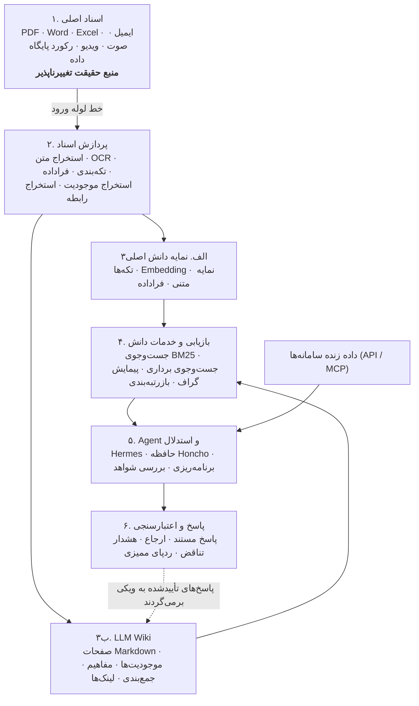

# معماری کامل دانش سازمانی (شش لایه)

این صفحه تصویر کلی **مسیر دانش** را از سند اصلی تا پاسخ مستند نشان می‌دهد و هر لایه را به مؤلفه‌ها و ابزارهای این پروژه نگاشت می‌کند.

## نگاشت لایه‌ها به مؤلفه‌ها

| لایه | اجزا | ابزار و فناوری این پروژه | صفحه مرتبط |
|---|---|---|---|
| **۱. اسناد اصلی** | نامه‌ها و پیوست‌ها، مقررات و مصوبات، صوت و ویدیوی جلسات، ایمیل، رکوردهای CMMS و قراردادها | Object storage داخلی (مثل MinIO) با Hash و شناسه پایدار؛ فهرست در PostgreSQL؛ فقط‌افزودنی | [پیوست‌ها](../requirements/attachments.md)، [نگهداری داده](data-residency.md) |
| **۲. پردازش اسناد** | استخراج متن، OCR فارسی، STT و تشخیص گوینده، تکه‌بندی (برای مقررات در سطح ماده/بند)، فراداده، موجودیت و رابطه | Docling، PyMuPDF، LibreOffice، 7-Zip، ezdxf؛ OCR فارسی؛ Whisper فارسی + pyannote؛ نرمال‌سازی فارسی؛ استخراج موجودیت با LLM | [پیوست‌ها](../requirements/attachments.md)، [دستیار زنده](../requirements/live-copilot.md) |
| **۳الف. نمایه دانش اصلی** | تکه‌ها، Embedding، نمایه متنی، فراداده (تاریخ، مرجع، طبقه‌بندی، ارتباط با مترو) | PostgreSQL + pgvector + FTS؛ Embedding چندزبانه محلی (BGE-M3)؛ در صورت نیاز OpenSearch / Qdrant | [لایه‌های حافظه](memory.md) |
| **۳ب. LLM Wiki** | صفحات موجودیت و موضوع، جمع‌بندی‌ها، لینک‌ها، `index.md`، `log.md` | Markdown در git داخلی؛ ingest و lint توسط Hermes؛ Obsidian برای مشاهده | [دانش ترکیبی](llm-wiki.md) |
| **۴. بازیابی و خدمات دانش** | BM25، برداری، پیمایش گراف، بازرتبه‌بندی | QMD (ویکی)، جست‌وجوی ترکیبی PostgreSQL (اسناد خام)، گراف دانش روی PostgreSQL؛ Haystack برای خط لوله‌های قطعی (بررسی)؛ GraphRAG در آینده؛ همه به‌صورت ابزار MCP | [گراف دانش](knowledge-graph.md) |
| **۵. Agent و استدلال** | ارکستراسیون، حافظه، برنامه‌ریزی، بررسی شواهد | Hermes Agent؛ Honcho؛ LLM از طریق دروازه LLM (تنها مؤلفه مجاز بیرونی)؛ API و MCP سامانه‌ها برای داده زنده | [اتصال به سامانه‌ها](integration.md) |
| **۶. پاسخ و اعتبارسنجی** | پاسخ مستند، ارجاع، هشدار تناقض، ردپای ممیزی | رابط مانیتور و چت؛ بررسی‌کننده شواهد؛ لاگ ممیزی در PostgreSQL؛ سنجش کیفیت با Ragas | [دستیار زنده](../requirements/live-copilot.md) |

## توضیح چند نکته

### دو مسیر موازی در لایه ۳

- **۳الف (نمایه اصلی)** نزدیک به سند است: برای **نقل دقیق** و ارجاع («بند ۴ مصوبه چه می‌گوید؟»).
- **۳ب (LLM Wiki)** دانش ترکیب‌شده است: برای **زمینه و تصویر کلی** («سابقه پیمانکار A»).
- هر دو از لایه ۲ تغذیه می‌شوند و هر صفحه ویکی به شناسه سند در لایه ۱ ارجاع می‌دهد.

### بررسی شواهد (Evidence checking)

پیش از نمایش پاسخ، Agent:

1. هر ادعای پاسخ را به حداقل یک منبع در لایه ۱ (یا رکورد زنده سامانه) وصل می‌کند؛ ادعای بدون منبع حذف یا با برچسب «بدون منبع» نشان داده می‌شود.
2. ادعاهای برگرفته از ویکی را با متن اصلی (۳الف) تطبیق می‌دهد، چون ویکی ممکن است کهنه یا اشتباه باشد.
3. اعتبار مقررات را از مخزن حقوقی (معتبر، منسوخ، ابطال‌شده) بررسی می‌کند.
4. عددهای عملیاتی را از API زنده می‌گیرد، نه از ویکی یا نمایه.

### هشدار تناقض

اگر دو منبع با هم تناقض داشته باشند (مثلاً نامه پیمانکار و رکورد CMMS، یا دو مقرره)، دستیار **هر دو را با منبع** نشان می‌دهد و خودش داوری نهایی نمی‌کند. تناقض‌های پیدا شده در Lint شبانه ویکی هم ثبت می‌شوند.

### ردپای ممیزی

برای هر پاسخ ثبت می‌شود: پرسش یا موضوع جلسه، منابع بازیابی‌شده، ابزارهای فراخوانده‌شده، داده‌ای که به LLM بیرونی رفت، و پاسخ نهایی. همه داخل سازمان.

## مواردی که به شکل اولیه اضافه شد

شکل پیشنهادی رضا با دو مؤلفه موجود در معماری قبلی تکمیل شد:

- **داده زنده سامانه‌ها** (CMMS، قراردادها و ...) مستقیم وارد لایه ۵ می‌شود، چون نباید از نمایه یا ویکی خوانده شود.
- **داده ساختاریافته** (تصمیم‌ها، رویدادها، مخزن حقوقی با اعتبار زمانی، گراف دانش) در PostgreSQL کنار لایه ۳الف قرار می‌گیرد و پیمایش گراف در لایه ۴ از آن استفاده می‌کند.
