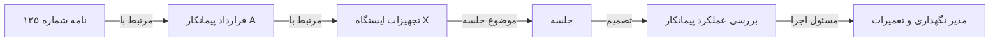

# گراف دانش سازمانی (Organizational Knowledge Graph)

سیستم باید ارتباط بین موجودیت‌ها را بفهمد تا وقتی درباره موضوعی سؤال می‌شود، **همه سوابق مرتبط** را پیدا کند؛ نه اینکه فقط چند متن مشابه برگرداند.

## موجودیت‌های اصلی (پیش‌نویس)

نامه، پیوست، ارجاع، بخشنامه، قانون، آیین‌نامه، اساسنامه، مصوبه شورای شهر، ماده/بند، قرارداد، پیمانکار، تجهیز، ایستگاه/محل، درخواست تعمیر، جلسه، گوینده، مصوبه/تصمیم، وظیفه/پیگیری، واحد سازمانی، شخص/سمت، پروژه، قلم انبار.

## روابط مقرراتی

روابط «اصلاح می‌کند»، «نسخ می‌کند»، «به استناد»، «ابطال شده توسط» با تاریخ اعتبار نگهداری می‌شوند. جزئیات: [دانش حقوقی و مقرراتی](../requirements/regulatory-knowledge.md).

## پیاده‌سازی

- برای شروع **PostgreSQL** با جداول رابطه‌ای (جدول موجودیت‌ها + جدول یال‌ها) کافی است.
- **Neo4j** اختیاری و در صورت نیاز به پرس‌وجوهای گرافی پیچیده.
- هر یال باید منبع (سند/رکورد/جلسه)، زمان ایجاد و میزان اطمینان داشته باشد تا قابل ردیابی باشد.
