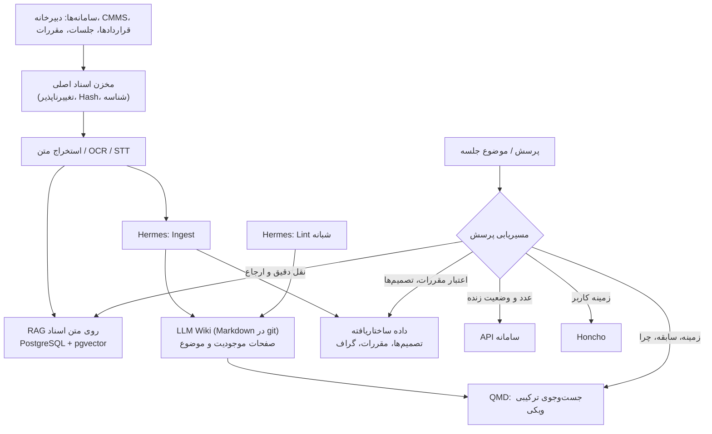

# دانش ترکیبی: LLM Wiki + RAG + حافظه Agent

!!! abstract "خلاصه"
    چیزی که می‌سازیم فقط یک برنامه RAG نیست؛ یک **سامانه دانش سازمانی** است با دانش پایدار، بازیابی اسناد، حافظه Agent، استدلال و کنترل کیفیت. پیشنهاد این است که سه سازوکار را **با هم** به کار ببریم:
    **حافظه Agent (Honcho)** برای زمینه کاربران و کارهای جاری، **RAG** برای بازیابی دقیق از اسناد اصلی، و **LLM Wiki** برای دانش به‌هم‌پیوسته و در حال تکامل که از اسناد ترکیب می‌شود.

## LLM Wiki چیست؟

ایده‌ای که Andrej Karpathy در آوریل ۲۰۲۶ منتشر کرد ([gist](https://gist.github.com/karpathy/442a6bf555914893e9891c11519de94f)). به‌جای اینکه مدل در هر سؤال دانش را **از صفر از اسناد خام کشف کند** (کاری که RAG می‌کند)، یک Agent به‌تدریج یک **ویکی Markdown پایدار و به‌هم‌پیوسته** می‌سازد و نگه می‌دارد که بین کاربر و اسناد خام قرار می‌گیرد. Karpathy آن را «یک محصول پایدار و انباشته‌شونده» می‌نامد.

### سه لایه

| لایه | محتوا | مالک |
|---|---|---|
| منابع خام (Raw sources) | اسناد اصلی؛ **تغییرناپذیر**؛ مدل فقط می‌خواند | انسان / سامانه‌ها |
| ویکی (Wiki) | صفحات Markdown ساخته مدل: خلاصه‌ها، صفحه هر موجودیت و مفهوم، مقایسه‌ها، نمای کلی، با لینک‌های متقابل | مدل |
| طرح‌واره (Schema) | سندی مثل `AGENTS.md` که ساختار، قراردادها و گردش‌کارها را تعریف می‌کند و انسان و مدل با هم تکاملش می‌دهند | انسان + مدل |

### سه عملیات

- **Ingest (افزودن منبع):** خواندن یک سند، نوشتن صفحه خلاصه، به‌روزرسانی صفحات موجودیت‌ها و مفاهیم مرتبط (یک سند ممکن است ۱۰ تا ۱۵ صفحه را تغییر دهد)، به‌روزرسانی `index.md` و افزودن به `log.md`.
- **Query (پرسش):** جست‌وجو در ویکی، خواندن صفحات و پاسخ با ارجاع. پاسخ‌های خوب می‌توانند به‌عنوان صفحه جدید به ویکی برگردند.
- **Lint (بررسی سلامت):** پیدا کردن تناقض‌ها، ادعاهای کهنه، صفحات یتیم، مفاهیم بدون صفحه و لینک‌های جاافتاده.

فایل‌های قراردادی: `index.md` (فهرست همه صفحات با خلاصه یک‌خطی، اولین چیزی که در پرسش خوانده می‌شود) و `log.md` (ثبت زمانی و فقط‌افزودنی همه ingest، query و lint).

### چرا مهم است

دلیل اینکه ویکی‌های سازمانی معمولاً رها می‌شوند این است که **هزینه نگهداری از ارزششان بیشتر می‌شود**. در LLM Wiki کارهای خسته‌کننده (خلاصه‌نویسی، لینک‌دهی، بایگانی) را مدل انجام می‌دهد و انسان فقط بازبینی و هدایت می‌کند.

## RAG در برابر LLM Wiki

| | RAG | LLM Wiki |
|---|---|---|
| ماهیت | **سازوکار بازیابی** | **معماری مدیریت دانش** |
| زمان پردازش | هنگام پرسش | هنگام افزودن سند (و بعد به‌روزرسانی مداوم) |
| انباشت دانش | ندارد؛ هر بار از نو | دارد؛ لینک‌ها، تناقض‌ها و جمع‌بندی‌ها می‌مانند و رشد می‌کنند |
| نقطه قوت | نقل دقیق از سند اصلی (ماده قانون، متن نامه) | پاسخ به «چرا» و «تصویر کلی» (سابقه یک پیمانکار، تاریخچه یک تجهیز) |
| ریسک | تکه‌های بی‌زمینه، تکرار کار | خطای ترکیب که در صفحات پخش می‌شود؛ نیاز به بازبینی |

نتیجه: **این دو رقیب نیستند.** ویکی تصویر کلی و زمینه را می‌دهد و RAG ادعاها را به سند اصلی بازمی‌گرداند.

## تفکیک مسئولیت‌ها (پیشنهاد)

| فناوری | نقش در سیستم | محل اجرا |
|---|---|---|
| **مخزن اسناد اصلی** | منبع حقیقت تغییرناپذیر: نامه‌ها، پیوست‌ها، صوت جلسات، مقررات؛ با شناسه و Hash | داخل سازمان (Object storage مثل MinIO + فهرست در PostgreSQL) |
| **Markdown** | قالب پایدار دانش ترکیبی (ویکی)؛ متن ساده، قابل diff، مستقل از ابزار | مخزن git داخلی (مثل Gitea) |
| **Obsidian** | محیط کار و نمایش دانش برای مدیران دانش: مرور صفحات، لینک‌ها و نمای گراف | کلاینت محلی؛ **بدون Obsidian Sync** (ابری است) |
| **Hermes** | Agent و ارکستراسیون: اجرای ingest، query و lint، فراخوانی ابزارها و MCPها | داخل سازمان |
| **LLM** | تحلیل، ترکیب و استدلال | تنها مؤلفه مجاز بیرونی ([نگهداری داده](data-residency.md)) |
| **QMD** | جست‌وجوی ترکیبی محلی روی Markdown: BM25 + برداری + بازرتبه‌بندی با LLM؛ CLI و MCP | داخل سازمان |
| **Honcho** | حافظه مکالمه‌ای Agent و کاربر (ترجیحات معاون، کارهای جاری) | داخل سازمان |
| **PostgreSQL + pgvector** | داده ساختاریافته: رویدادها، تصمیم‌ها، مخزن حقوقی با اعتبار زمانی، گراف دانش، جست‌وجوی برداری روی متن اسناد خام | داخل سازمان |

### درباره QMD

- موتور جست‌وجوی محلی از Tobi Lütke، مجوز **MIT** ([مخزن](https://github.com/tobi/qmd)).
- ترکیب جست‌وجوی متنی BM25 (SQLite FTS5)، جست‌وجوی برداری و بازرتبه‌بندی با مدل‌های GGUF محلی (node-llama-cpp)، با گسترش پرسش و ادغام نتایج (RRF).
- سرور **MCP** دارد (ابزارهای `query`، `get`، `multi_get`، `status`) و Hermes یک [مهارت QMD](https://hermes-agent.nousresearch.com/docs/user-guide/skills/optional/research/research-qmd) دارد.
- قابلیت «Context» درختی: برای هر مجموعه/پوشه توضیح زمینه ثبت می‌شود و همراه نتایج برمی‌گردد.
- Karpathy آن را برای وقتی پیشنهاد می‌کند که ویکی از `index.md` بزرگ‌تر می‌شود.

## ترکیب پیشنهادی برای دستیار مترو



### مسیریابی پرسش

| نوع پرسش | منبع | مثال |
|---|---|---|
| داده زنده | API مستقیم | «الان چند درخواست تعمیر باز داریم؟» |
| نقل دقیق و ارجاع | RAG روی اسناد اصلی | «بند ۴ مصوبه شورا درباره بهای بلیت چه می‌گوید؟» |
| زمینه و ترکیب | LLM Wiki (از طریق QMD) | «سابقه پیمانکار A و مشکلات پمپ‌های ایستگاه X چیست؟» |
| اعتبار و وضعیت رسمی | PostgreSQL (مخزن حقوقی، تصمیم‌ها) | «آیا این بخشنامه هنوز معتبر است؟» |
| زمینه کاربر | Honcho | «موضوعاتی که معاون هفته پیش پیگیرشان بود» |

در عمل یک پاسخ خوب معمولاً ترکیبی است: ویکی تصویر کلی را می‌دهد، RAG ادعاها را به سند اصلی وصل می‌کند و API عددهای امروز را می‌آورد.

### ساختار پیشنهادی ویکی

```text
wiki/
├── AGENTS.md            # طرح‌واره: قواعد نوشتن، قالب صفحات، قواعد ارجاع
├── index.md             # فهرست همه صفحات با خلاصه یک‌خطی
├── log.md               # ثبت زمانی ingest / query / lint
├── stations/            # هر ایستگاه یک صفحه
├── equipment/           # تجهیزات و ناوگان
├── contractors/         # پیمانکاران
├── contracts/           # قراردادها (خلاصه + لینک به سند و رکورد سامانه)
├── departments/         # مدیریت‌ها، شرح وظایف، مسئولیت‌ها
├── regulations/         # موضوعات مقرراتی (توضیح + لینک به مواد در مخزن حقوقی)
├── meetings/            # جلسات و مصوبات
├── decisions/           # تصمیم‌ها و وضعیت پیگیری
└── topics/              # موضوعات میان‌بخشی (مثلاً «خرابی پمپ‌ها»)
```

## تطبیق با شرایط پروژه، تعارض‌ها و راه‌حل‌ها

!!! warning "ایده Karpathy برای دانش شخصی طراحی شده؛ برای یک سازمان باید تطبیق داده شود"

| موضوع | تعارض | راه‌حل پیشنهادی |
|---|---|---|
| **مقیاس** | Karpathy می‌گوید `index.md` تا حدود ۱۰۰ منبع و چند صد صفحه خوب کار می‌کند؛ دبیرخانه ده‌ها هزار نامه دارد | هر نامه صفحه جدا **نمی‌گیرد**؛ ویکی در سطح **موجودیت و موضوع** است و نامه‌ها فقط صفحات موجود را به‌روز می‌کنند. QMD از روز اول؛ RAG روی کل متن اسناد خام |
| **کنترل دسترسی** | Markdown و Obsidian دسترسی سطح صفحه ندارند؛ نامه‌های محرمانه داریم | ویکی‌های جدا بر اساس **سطح طبقه‌بندی**؛ دسترسی کاربران از طریق رابط دستیار (که ACL را اعمال می‌کند) نه مستقیم به فایل‌ها؛ Obsidian فقط برای مدیران دانش |
| **انباشت خطا** | جمع‌بندی اشتباه مدل در چند صفحه پخش می‌شود | هر جمله ویکی باید به **شناسه سند اصلی** ارجاع دهد؛ Lint شبانه؛ بازبینی انسانی صفحات مهم؛ git برای دیدن و برگرداندن هر تغییر |
| **مخزن حقوقی** | وضعیت اعتبار مقررات (معتبر، منسوخ) نباید در متن آزاد ویکی باشد | منبع حقیقت اعتبار، **PostgreSQL** است؛ صفحات `regulations/` فقط توضیح و لینک‌اند و وضعیت را از پایگاه داده می‌خوانند. [دانش حقوقی](../requirements/regulatory-knowledge.md) |
| **داده زنده** | ویکی می‌تواند عدد کهنه نگه دارد | عددهای عملیاتی در ویکی نوشته نمی‌شوند یا با تاریخ «تا این تاریخ» می‌آیند؛ پاسخ زنده همیشه از API |
| **زبان فارسی** | مدل Embedding پیش‌فرض QMD (embeddinggemma) انگلیسی‌محور است؛ BM25 در SQLite نرمال‌سازی فارسی ندارد | تنظیم `QMD_EMBED_MODEL` روی مدل چندزبانه (مثلاً Qwen3-Embedding)؛ نرمال‌سازی متن فارسی (ی/ي، ک/ك، نیم‌فاصله) هنگام ingest؛ ارزیابی کیفیت جست‌وجو روی پرسش‌های واقعی |
| **نگهداری داده** | QMD مدل‌ها را خودکار از HuggingFace دانلود می‌کند؛ Obsidian Sync ابری است | مدل‌ها از پیش دانلود و آفلاین نصب شوند؛ فقط git داخلی؛ بدون همگام‌سازی ابری |
| **ارسال متن به LLM بیرونی** | ingest یعنی متن اسناد برای خلاصه‌نویسی به LLM می‌رود | همان قاعده [نگهداری داده](data-residency.md): فقط سطوح مجاز، یا مدل محلی برای اسناد محرمانه |
| **دوگانگی QMD و pgvector** | دو موتور جست‌وجو | QMD برای ویکی Markdown (کوچک‌تر، مناسب Agent)؛ PostgreSQL برای حجم بزرگ اسناد خام با فیلتر فراداده و ACL. در نمونه اولیه می‌شود فقط با QMD شروع کرد |
| **مقیاس QMD** | QMD تک‌سرور و مبتنی بر SQLite است | برای ویکی کافی است؛ برای مقیاس بالاتر جایگزین با جست‌وجوی ترکیبی PostgreSQL |
| **Obsidian** | نرم‌افزار متن‌باز نیست و شرایط مجوز استفاده سازمانی باید بررسی شود؛ نمایش راست‌به‌چپ باید آزمایش شود | فقط ابزار مشاهده است و جایگزین‌پذیر؛ ویکی به Obsidian وابسته نیست چون Markdown ساده است |

## پیامد برای فازبندی

- **فاز ۱:** مخزن اسناد اصلی، RAG، و ویکی اولیه برای دبیرخانه و مقررات؛ QMD؛ Lint شبانه.
- **فاز ۲:** صفحات جلسات و تصمیم‌ها؛ Honcho.
- **فاز ۳ به بعد:** صفحات ایستگاه، تجهیز و پیمانکار با داده سامانه‌های عملیاتی.

## منابع

- [Karpathy: LLM Wiki (gist)](https://gist.github.com/karpathy/442a6bf555914893e9891c11519de94f)
- [QMD: Query Markup Documents](https://github.com/tobi/qmd)
- [Hermes Agent: QMD skill](https://hermes-agent.nousresearch.com/docs/user-guide/skills/optional/research/research-qmd)
