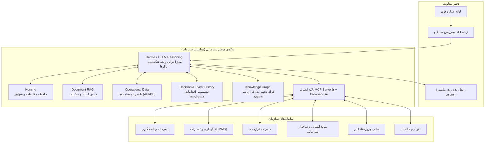

# معماری: نمای کلی

## لایه‌ها

| لایه | نقش |
|---|---|
| ورودی/خروجی دفتر | میکروفون، ضبط، STT زنده، رابط مانیتور |
| ارکستراسیون | Hermes Agent + مدل زبانی؛ برنامه‌ریزی، فراخوانی ابزار، ساخت مهارت |
| حافظه و دانش | چهار لایه + گراف دانش؛ جزئیات در [لایه‌های حافظه](memory.md) و [گراف دانش](knowledge-graph.md) |
| اتصال | MCP برای سامانه‌های دارای API؛ Browser-use برای سامانه‌های فاقد API؛ جزئیات در [اتصال به سامانه‌ها](integration.md) |
| سامانه‌های سازمان | منابع داده؛ در فاز ۱ فقط خواندنی |

## اصل کلیدی

سیستم یک **پلتفرم مستقل و قابل اتصال** است، نه یک Agent که مستقیماً به چند نرم‌افزار وصل شده و منطق سازمان را داخل Prompt خودش نگه می‌دارد.
