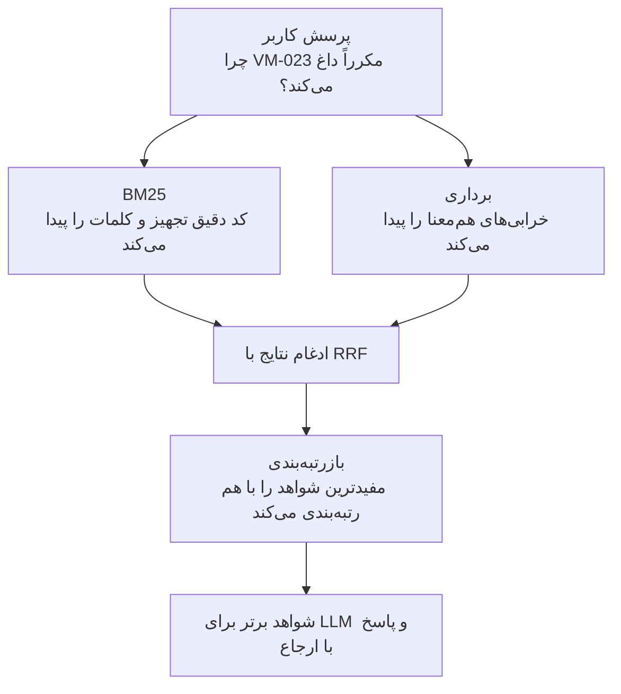

# BM25: الگوریتم رتبه‌بندی جست‌وجوی متنی

!!! abstract "در یک جمله"
    **BM25** (Best Matching 25) الگوریتمی است که تعیین می‌کند کدام سندها با **کلمات** پرسش شما بیشترین ارتباط را دارند. یکی از پایه‌های موتورهای جست‌وجوی متنی سنتی است؛ همان چیزی که پشت جست‌وجوی یک عبارت در یک سامانه مدیریت اسناد کار می‌کند، **پیش از** جست‌وجوی معنایی هوش مصنوعی.

## ایده اصلی با زبان ساده

فرض کنید در دبیرخانه دنبال «خرابی پمپ ایستگاه» می‌گردید. یک انسان به‌طور طبیعی این‌طور قضاوت می‌کند:

1. **سندی که کلمات پرسش را دارد مرتبط‌تر است.** و اگر کلمه را چند بار تکرار کرده باشد، احتمالاً بیشتر درباره همان موضوع است. *(فراوانی کلمه: TF)*
2. **همه کلمات ارزش یکسان ندارند.** کلمه «ایستگاه» در تقریباً همه نامه‌های مترو هست، پس پیدا شدنش چیز زیادی نمی‌گوید. اما «پمپ» کمیاب‌تر است و ارزش بیشتری دارد. *(کمیابی کلمه: IDF)*
3. **تکرار، اثرش اشباع می‌شود.** نامه‌ای که «خرابی» را ۲۰ بار نوشته، ۲۰ برابر مرتبط‌تر از نامه‌ای که یک بار نوشته نیست. *(اشباع: پارامتر k1)*
4. **سند بلند به‌طور طبیعی کلمات بیشتری دارد.** یک گزارش ۵۰ صفحه‌ای احتمالاً «پمپ» را جایی دارد، حتی اگر موضوعش چیز دیگری باشد. پس سند کوتاهی که کلمه را دارد امتیاز بیشتری می‌گیرد. *(نرمال‌سازی طول: پارامتر b)*

BM25 همین چهار شهود را در یک فرمول جمع می‌کند.

## فرمول

امتیاز سند D برای پرسش Q برابر است با جمع امتیاز هر کلمه q از پرسش:

```text
              ┌                         f(q,D) · (k1 + 1)                      ┐
score(D,Q) = Σ │ IDF(q) · ───────────────────────────────────────────────── │
             q∈Q└          f(q,D) + k1 · (1 − b + b · |D| / avgdl)            ┘

IDF(q) = ln( (N − n(q) + 0.5) / (n(q) + 0.5) + 1 )
```

| نماد | معنی |
|---|---|
| `f(q,D)` | چند بار کلمه q در سند D آمده (TF) |
| `|D|` | طول سند D (تعداد کلمات) |
| `avgdl` | میانگین طول سندها در مجموعه |
| `N` | تعداد کل سندها |
| `n(q)` | تعداد سندهایی که کلمه q را دارند |
| `k1` | کنترل اشباع تکرار؛ معمولاً بین ۱٫۲ و ۲ |
| `b` | شدت نرمال‌سازی طول؛ معمولاً ۰٫۷۵ (صفر یعنی طول اهمیتی ندارد، یک یعنی نرمال‌سازی کامل) |

## مثال عددی با متن مترو

چهار سند کوتاه داریم (k1 = 1.2 و b = 0.75):

| سند | متن | طول |
|---|---|---|
| D1 | خرابی پمپ ایستگاه زند در سه ماه اخیر تکرار شده است | ۱۱ |
| D2 | گزارش تعمیر پمپ ایستگاه زند | ۵ |
| D3 | خرابی پله برقی ایستگاه شهدا و خرابی تابلو برق ایستگاه | ۱۰ |
| D4 | صورت جلسه بودجه سال آینده سازمان | ۶ |

میانگین طول (avgdl) = ۸. پرسش: **«خرابی پمپ ایستگاه»**

### گام ۱: IDF هر کلمه

| کلمه | در چند سند آمده (n) | IDF |
|---|---|---|
| خرابی | ۲ | ۰٫۶۹۳ |
| پمپ | ۲ | ۰٫۶۹۳ |
| ایستگاه | ۳ | **۰٫۳۵۷** |

«ایستگاه» چون رایج‌تر است، وزنش تقریباً نصف است.

### گام ۲: امتیاز هر سند

| سند | خرابی | پمپ | ایستگاه | **جمع** | رتبه |
|---|---|---|---|---|---|
| D1 | ۰٫۶۰۱ | ۰٫۶۰۱ | ۰٫۳۰۹ | **۱٫۵۱۱** | ۱ |
| D3 | ۰٫۸۹۰ (دو بار) | ۰ | ۰٫۴۵۸ (دو بار) | **۱٫۳۴۹** | ۲ |
| D2 | ۰ | ۰٫۸۱۹ | ۰٫۴۲۱ | **۱٫۲۴۰** | ۳ |
| D4 | ۰ | ۰ | ۰ | **۰** | ۴ |

### چه چیزی از این مثال یاد می‌گیریم؟

- **D1 اول است** چون هر سه کلمه را دارد؛ همان چیزی که دنبالش بودیم.
- **اشباع تکرار:** «خرابی» در D3 دو بار آمده، اما امتیازش ۰٫۸۹ است، نه دو برابر ۰٫۶۰ (یعنی ۱٫۲۰).
- **نرمال‌سازی طول:** «پمپ» در D2 (سند کوتاه، ۵ کلمه) امتیاز ۰٫۸۱۹ گرفته، اما در D1 (سند بلند، ۱۱ کلمه) فقط ۰٫۶۰۱.
- **محدودیت:** D3 درباره پله‌برقی و تابلو برق است، نه پمپ، اما از D2 که واقعاً درباره پمپ است بالاتر آمده، چون دو کلمه از سه کلمه پرسش را تکرار کرده. BM25 **معنا را نمی‌فهمد**؛ فقط کلمات را می‌شمارد.

## BM25 در برابر جست‌وجوی معنایی (برداری) {#bm25-vs-vector}

!!! important "مهم‌ترین تمایز در معماری RAG ما"

| BM25 | جست‌وجوی برداری |
|---|---|
| **کلمات** را تطبیق می‌دهد | **معنا** را تطبیق می‌دهد |
| عالی برای اصطلاحات و کدهای دقیق | عالی برای شباهت معنایی |
| مدل Embedding لازم ندارد | مدل Embedding لازم دارد |
| کد تجهیز `VM-023` را **دقیقاً** پیدا می‌کند | ممکن است بفهمد «موتور تهویه» و «هواساز» به هم مربوط‌اند |
| جست‌وجوی واژگانی (Lexical) | جست‌وجوی معنایی (Semantic) |

### مقایسه با مثال‌های مترو

| پرسش یا موقعیت | BM25 | برداری |
|---|---|---|
| کد تجهیز `VM-023`، شماره نامه، شماره مصوبه، «ماده ۵» | ✅ دقیق | ⚠️ ضعیف؛ `VM-023` و `VM-032` یا «ماده ۵» و «ماده ۷» را شبیه می‌بیند |
| «ازکارافتادگی پمپ» وقتی پرسش «خرابی پمپ» است | ❌ کلمه مشترک ندارد | ✅ هم‌معنا را پیدا می‌کند |
| «موتور تهویه» و «هواساز» و «فن تونل» | ❌ سه کلمه متفاوت | ✅ رابطه را می‌فهمد |
| نام ایستگاه، نام پیمانکار | ✅ | ⚠️ متوسط |
| غلط تایپی یا OCR | ❌ | ✅ تا حدی مقاوم |
| سرعت و هزینه | بسیار سریع، بدون GPU | نیاز به مدل و معمولاً GPU |
| قابل توضیح بودن | کامل (می‌دانیم چرا آمد) | کمتر |

## جست‌وجوی ترکیبی (Hybrid) با یک مثال {#hybrid}

هیچ‌کدام به‌تنهایی کافی نیست. پرسش نمونه: **«چرا VM-023 مکرراً داغ می‌کند؟»**



فرض کنید این چهار سند در سیستم هست:

| سند | محتوا |
|---|---|
| A | درخواست تعمیر **VM-023**: «قطع حرارتی موتور» |
| B | گزارش «**داغ شدن موتور هواساز** ایستگاه زند» (بدون ذکر کد) |
| C | نامه پیمانکار درباره تمدید قرارداد تعمیر **VM-023** (ربطی به داغ شدن ندارد) |
| D | دستورالعمل نگهداری **فن‌های تهویه**: تمیزکاری فیلتر برای جلوگیری از **افزایش دما** |

نتیجه هر روش:

| رتبه | BM25 | برداری |
|---|---|---|
| ۱ | A | B |
| ۲ | C | D |
| ۳ | D | A |

- BM25 سند B را اصلاً پیدا نکرد، چون کد `VM-023` و کلمه «داغ» عیناً در آن نیست.
- جست‌وجوی برداری سند C را پیدا نکرد، چون معنایش (قرارداد) به پرسش (داغ شدن) نزدیک نیست.

### RRF چطور ادغام می‌کند؟ {#rrf}

**RRF (Reciprocal Rank Fusion)** به امتیاز خام توجه نمی‌کند (چون امتیاز BM25 و شباهت برداری قابل مقایسه نیستند) و فقط از **رتبه** استفاده می‌کند:

```text
RRF(سند) = Σ  1 / (k + رتبه سند در هر فهرست)          معمولاً k = 60
```

| سند | رتبه BM25 | رتبه برداری | محاسبه | امتیاز RRF | رتبه نهایی |
|---|---|---|---|---|---|
| A | ۱ | ۳ | 1/61 + 1/63 | **۰٫۰۳۲۳** | ۱ |
| D | ۳ | ۲ | 1/63 + 1/62 | **۰٫۰۳۲۰** | ۲ |
| B | — | ۱ | 1/61 | **۰٫۰۱۶۴** | ۳ |
| C | ۲ | — | 1/62 | **۰٫۰۱۶۱** | ۴ |

**نکته کلیدی:** سندی که در **هر دو** فهرست آمده (A و D) بالا می‌رود، حتی اگر در هیچ‌کدام اول نبوده باشد (D). یعنی RRF به «توافق» دو روش پاداش می‌دهد. مقدار `k = 60` اثر اختلاف رتبه‌های بالا را نرم می‌کند تا یک فهرست به‌تنهایی نتیجه را تعیین نکند.

### بازرتبه‌بندی (Reranking)

پس از RRF، یک مدل **بازرتبه‌بند** پرسش و هر سند را **کنار هم** می‌خواند و ارتباط واقعی را می‌سنجد. در این مثال احتمالاً B را بالاتر از C می‌برد، چون B واقعاً درباره داغ شدن است و C درباره قرارداد. بازرتبه‌بند کندتر است، پس فقط روی چند ده نتیجه اول اجرا می‌شود.

**نتیجه برای LLM:** A (سابقه خرابی خود VM-023)، D (علت احتمالی: فیلتر)، B (مشکل مشابه در تجهیز هم‌نوع). پاسخ نهایی می‌تواند بگوید: «طبق درخواست تعمیر A، VM-023 بارها قطع حرارتی داشته؛ طبق دستورالعمل D، گرفتگی فیلتر از علل رایج افزایش دماست؛ مورد مشابه B در ایستگاه زند هم گزارش شده.» با ارجاع به هر سه سند.

## BM25 و زبان فارسی {#persian}

BM25 روی «کلمه» کار می‌کند، پس کیفیت آن به این بستگی دارد که متن فارسی درست به کلمه تبدیل شود:

| مشکل | مثال | راه‌حل |
|---|---|---|
| حروف عربی و فارسی | «ي» و «ی»، «ك» و «ک» | یکسان‌سازی پیش از نمایه‌سازی |
| نیم‌فاصله | «می‌شود»، «میشود» و «می شود» | یکسان‌سازی نیم‌فاصله |
| پسوندها | «پمپ»، «پمپ‌ها»، «پمپهای» | ریشه‌یابی یا Lemmatization (مثلاً با Hazm) |
| اعداد | «۱۲۳» و «123» | تبدیل همه به یک شکل |
| غلط OCR | کلمات شکسته در اسکن | کنترل کیفیت OCR؛ جست‌وجوی برداری به‌عنوان مکمل |

## BM25 در فناوری‌های پروژه {#in-our-stack}

| ابزار | وضعیت BM25 |
|---|---|
| **PostgreSQL FTS** | جست‌وجوی متنی داخلی PostgreSQL رتبه‌بندی خودش (`ts_rank`) را دارد که **دقیقاً BM25 نیست** (IDF و نرمال‌سازی طول به شکل BM25 ندارد). برای BM25 واقعی می‌توان از افزونه‌ها (مثل `pg_search` از ParadeDB) استفاده کرد. پیکربندی فارسی آماده ندارد و باید از پیکربندی `simple` + نرمال‌سازی خودمان استفاده کرد. **پیمانکار باید این را در نمونه اولیه بسنجد.** |
| **OpenSearch** | رتبه‌بندی پیش‌فرضش BM25 است و تحلیلگر (Analyzer) فارسی دارد. سرویس سنگین‌تری است. |
| **QMD** | از BM25 در SQLite FTS5 استفاده می‌کند و آن را با جست‌وجوی برداری (RRF) و بازرتبه‌بندی ترکیب می‌کند؛ همان الگوی بالا. |

!!! tip "برای پروژه ما"
    - شماره نامه، شماره مصوبه، شماره ماده، کد تجهیز و نام ایستگاه‌ها **باید** با BM25 (یا تطبیق دقیق) قابل جست‌وجو باشند.
    - کیفیت هر دو مسیر با **مجموعه آزمون فارسی** و Ragas سنجیده شود.

## بعدی

[QMD](qmd.md): ترکیب BM25، جست‌وجوی برداری و بازرتبه‌بندی در عمل.

## برای مطالعه بیشتر

- [Okapi BM25 در ویکی‌پدیا](https://en.wikipedia.org/wiki/Okapi_BM25)
- [Elastic: Practical BM25](https://www.elastic.co/blog/practical-bm25-part-2-the-bm25-algorithm-and-its-variables)
- [QMD](https://github.com/tobi/qmd) (نمونه عملی جست‌وجوی ترکیبی)
