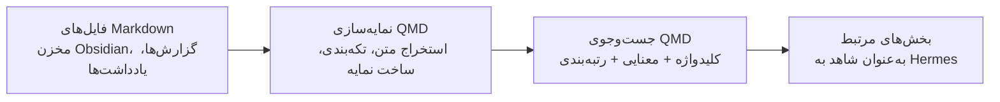
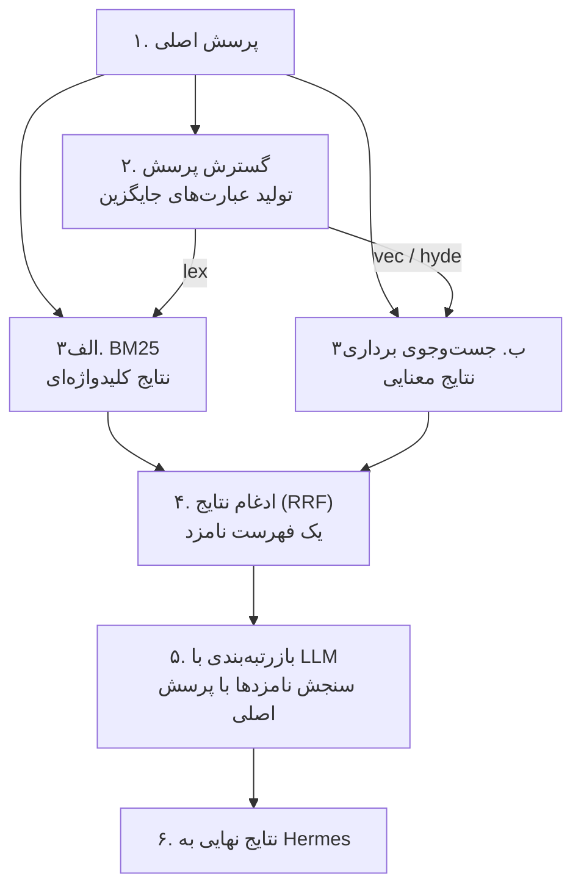
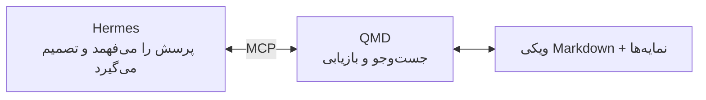
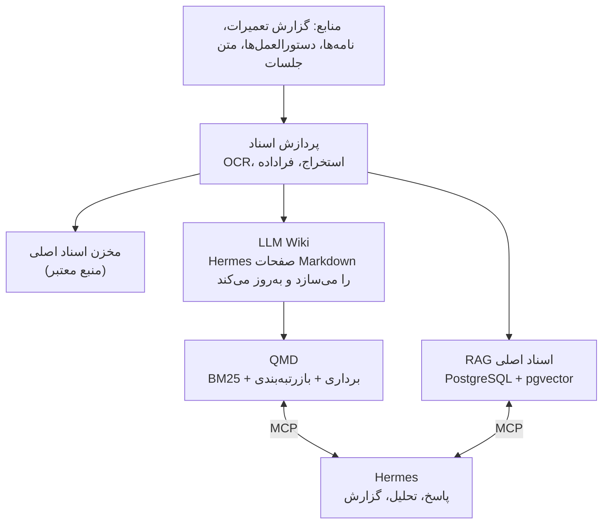

# QMD: مبانی و ایده کامل

!!! abstract "در یک جمله"
    **QMD** (Query Markup Documents) یک **موتور جست‌وجو برای پایگاه دانش Markdown** است. کمک می‌کند در میان هزاران فایل Markdown اطلاعات درست را پیدا کنید، با چیزی بیشتر از تطبیق ساده کلمات. کاملاً روی سرور خودمان اجرا می‌شود (مجوز MIT). [مخزن QMD](https://github.com/tobi/qmd)

!!! tip "پیش‌نیاز"
    اگر BM25 را نمی‌شناسید، اول [آموزش BM25](bm25.md) و [نمایه معکوس](inverted-index.md) را بخوانید. این صفحه روی آن‌ها بنا شده است.

## ۱. QMD چه مشکلی را حل می‌کند؟

فرض کنید یک مخزن Obsidian با ۵٬۰۰۰ فایل Markdown درباره مترو داریم: دستورالعمل تجهیزات، گزارش‌های تعمیرات، صورت‌جلسه‌ها، مشخصات فنی، صفحات [LLM Wiki](../architecture/llm-wiki.md) و روابط تجهیزات، ایستگاه‌ها و حوادث. از Hermes می‌پرسیم:

> **«علت‌های تکراری داغ شدن موتورهای تهویه در ایستگاه‌های خط ۱ چه بوده است؟»**

جست‌وجوی ساده فایل دنبال عین کلمات «داغ شدن» و «موتور تهویه» می‌گردد. اما اطلاعات مرتبط ممکن است این‌طور نوشته شده باشد:

- «دمای موتور از حد مجاز کارکرد بالاتر رفت.»
- «خرابی فن خنک‌کننده باعث مشکل حرارتی شد.»
- «اصطکاک بیش از حد یاتاقان دمای کارکرد را افزایش داد.»
- «واحد هواساز گرمای غیرعادی داشت.»

**مشکل:** اسناد یک مفهوم را با کلمات متفاوت توصیف می‌کنند. QMD این مشکل را با **ترکیب چند روش جست‌وجو** حل می‌کند.

### بدون هوش مصنوعی شروع کنیم

```text
Metro-Knowledge/
├── Equipment/
│   ├── Ventilation-Motor-VM-102.md
│   ├── Ventilation-Motor-VM-103.md
│   └── Cooling-System.md
├── Maintenance/
│   ├── Report-2026-001.md
│   ├── Report-2026-002.md
│   └── Report-2026-003.md
└── Meetings/
    ├── Maintenance-Meeting-January.md
    └── Maintenance-Meeting-February.md
```

Markdown فقط یک قالب متنی است (متن، عنوان، فهرست، جدول، لینک و فراداده). با ۲۰ فایل می‌شود دستی گشت؛ با ۲۰٬۰۰۰ فایل نه. سیستمی لازم داریم که:

1. ساختار فایل‌ها را بخواند و بفهمد؛
2. **نمایه** بسازد تا برای هر سؤال لازم نباشد همه فایل‌ها را بخواند؛
3. هنگام سؤال، بخش‌های مرتبط را پیدا کند؛
4. نتایج را رتبه‌بندی کند تا مفیدترین‌ها اول بیایند؛
5. نتایج را به Hermes یا LLM دیگر بدهد.

این کار QMD است.



QMD قالب خاصی از Markdown نیست. با فایل‌های Markdown معمولی کار می‌کند و نمایه‌های خودش را کنار آن‌ها می‌سازد (در یک پایگاه داده SQLite). **فایل‌های اصلی دست نمی‌خورند.**

## ۲. سه روش پایه جست‌وجو

مهم‌ترین بخش یادگیری QMD همین است.

### الف. BM25: پیدا کردن کلمات

| سند | محتوا |
|---|---|
| A | موتور تهویه VM-102 دچار داغ شدن شد. |
| B | خرابی فن خنک‌کننده باعث دمای بالای موتور شد. |
| C | سیستم روشنایی ایستگاه نیاز به بازرسی دارد. |

پرسش: «گزارش‌های داغ شدن موتور تهویه». BM25 دنبال «موتور»، «تهویه» و «داغ» می‌گردد:

- **A** تطبیق قوی دارد (همه کلمات را دارد).
- **B** امتیاز ضعیف‌تری می‌گیرد («موتور» را دارد ولی «تهویه» و «داغ» را نه).
- **C** امتیاز تقریباً صفر.

**قوت:** کلمات دقیق، کد تجهیز، شماره مدل، نام‌ها و اصطلاحات فنی. **ضعف:** نمی‌فهمد دو عبارت متفاوت یک مفهوم‌اند. ([جزئیات BM25](bm25.md))

### ب. جست‌وجوی برداری: پیدا کردن معنا

پرسش: «کدام گزارش‌ها می‌گویند موتورها به‌طور غیرعادی گرم شده‌اند؟» سند مرتبط می‌گوید: «فن خنک‌کننده از کار افتاد و دمای موتور از محدوده عادی کارکرد بالاتر رفت.» عبارت «به‌طور غیرعادی گرم» در سند نیست و جست‌وجوی کلیدواژه‌ای ممکن است آن را از دست بدهد.

جست‌وجوی برداری از یک **مدل Embedding** استفاده می‌کند که متن را به یک **بردار** (فهرستی از اعداد) تبدیل می‌کند:

| جمله | بردار (اعداد نمایشی، نه خروجی واقعی) |
|---|---|
| «موتور داغ کرده است.» | `[0.82, 0.15, 0.67, 0.34, 0.91, …]` |
| «دمای موتور از حد عادی بالاتر رفت.» | `[0.79, 0.19, 0.71, 0.31, 0.87, …]` |
| «روشنایی ایستگاه بازرسی شود.» | `[0.11, 0.88, 0.05, 0.72, 0.20, …]` |

ایده کلیدی: **جمله‌های هم‌معنا بردارهای نزدیک به هم دارند.** یک معیار رایج برای سنجش نزدیکی، **شباهت کسینوسی** است:

```text
cosine(A, B) = (A · B) / (|A| × |B|)        عددی بین −1 و 1؛ هرچه به 1 نزدیک‌تر، هم‌معناتر
```

لازم نیست همه ریاضی آن را الان بدانید. نکته اصلی: **BM25 کلمات را مقایسه می‌کند؛ جست‌وجوی برداری بازنمایی عددی معنا را.**

**قوت:** مفاهیم، بازنویسی‌ها و توصیف‌های زبان طبیعی. **ضعف:** ممکن است کد فنی دقیق را از دست بدهد یا چیزهای شبیه ولی متفاوت را قاطی کند (مثلاً VM-102 و VM-103 توصیف تقریباً یکسانی دارند).

### ج. بازرتبه‌بندی: تصمیم درباره بهترین نتایج

فرض کنید ۲۰ بخش پیدا شده؛ بعضی واقعاً مرتبط‌اند و بعضی فقط موضوع مشابهی دارند. **بازرتبه‌بند** (Reranker) پرسش اصلی و هر بخش را کنار هم می‌خواند و میزان تطبیق را می‌سنجد:

| بخش بازیابی‌شده | ارزیابی بازرتبه‌بند |
|---|---|
| داغ شدن VM-102 به دلیل خرابی یاتاقان | بسیار مرتبط |
| روش بازرسی فن خنک‌کننده | مرتبط |
| دستورالعمل عمومی نگهداری موتور | کمی مرتبط |
| بازرسی روشنایی ایستگاه | نامرتبط |

**تقسیم کار:** BM25 و جست‌وجوی برداری **نامزدها را پیدا می‌کنند**؛ بازرتبه‌بند **با دقت بیشتری درباره‌شان قضاوت می‌کند.** به همین دلیل جست‌وجوی ترکیبی QMD از هر روش تنها مفیدتر است.

## ۳. QMD این‌ها را چطور ترکیب می‌کند؟

Hermes می‌پرسد: «علت‌های اصلی داغ شدن موتور تهویه چیست؟»



### جزئیات واقعی خط لوله `qmd query` (از مستندات QMD)

1. **گسترش پرسش:** پرسش اصلی (با **وزن دو برابر**) + یک پرسش جایگزین که یک مدل کوچک محلی تولید می‌کند.
2. **بازیابی موازی:** هر پرسش هم در نمایه متنی (BM25) و هم در نمایه برداری جست‌وجو می‌شود.
3. **ادغام با RRF** با `k = 60` ([مثال عددی RRF](bm25.md#rrf)).
4. **پاداش رتبه بالا:** سندی که در هر فهرستی رتبه ۱ باشد ‎+0.05 و رتبه ۲ یا ۳ ‎+0.02 می‌گیرد، تا تطبیق دقیق در ادغام گم نشود.
5. **۳۰ نامزد برتر** به بازرتبه‌بند می‌روند.
6. **بازرتبه‌بندی:** یک مدل محلی (`qwen3-reranker`) برای هر سند ارتباط را می‌سنجد.
7. **ترکیب وابسته به رتبه:** برای رتبه‌های ۱ تا ۳، ۷۵٪ امتیاز بازیابی و ۲۵٪ بازرتبه‌بند؛ برای رتبه‌های ۴ تا ۱۰، ۶۰/۴۰؛ برای رتبه ۱۱ به بعد، ۴۰/۶۰. یعنی بازرتبه‌بند نمی‌تواند نتایج بسیار مطمئن بازیابی را خراب کند.

### RRF در یک نگاه

BM25 می‌دهد: A، B، C. برداری می‌دهد: C، A، D. RRF فهرست‌ها را بر اساس **رتبه** (نه امتیاز) ترکیب می‌کند و به سندهایی که در بالای هر فهرست هستند پاداش می‌دهد. نیازی نیست امتیاز دو سیستم قابل مقایسه باشد، که خوب است چون امتیاز BM25 (۰ تا ۲۵+) و شباهت برداری (۰ تا ۱) اصلاً هم‌مقیاس نیستند. نتیجه: A و C که در هر دو فهرست بالا هستند اول می‌آیند.

## ۴. نمایه‌سازی: آماده‌سازی پیش از جست‌وجو

آیا QMD برای هر سؤال همه فایل‌ها را از اول می‌خواند؟ **نه.** بازنمایی‌های قابل جست‌وجو را از قبل می‌سازد.

### گام ۱: ثبت یک مجموعه (Collection)

مجموعه یعنی پوشه‌ای از اسناد که QMD باید جست‌وجو کند:

```sh
qmd collection add ~/Metro-Knowledge --name metro
```

می‌توان چند مجموعه داشت: `wiki` (ویکی دانش)، `meetings` (متن جلسات)، `manuals` (دستورالعمل‌ها).

### گام ۲: Context (ویژگی کلیدی که زیاد دیده نمی‌شود)

برای هر مجموعه یا پوشه یک توضیح ثبت می‌شود که همراه نتایج برمی‌گردد و به LLM کمک می‌کند بفهمد هر نتیجه از کجا آمده:

```sh
qmd context add qmd://metro "پایگاه دانش سازمان قطار شهری شیراز"
qmd context add qmd://metro/Maintenance "گزارش‌های تعمیرات؛ منبع اصلی آن‌ها در CMMS است"
```

### گام ۳: تکه‌بندی (Chunking)

یک فایل ۵٬۰۰۰ کلمه‌ای درباره سیستم تهویه را بهتر است یک‌جا به مدل Embedding ندهیم:

```text
Ventilation-System.md
├── تکه ۱: نمای کلی سیستم
├── تکه ۲: مشخصات موتور
├── تکه ۳: سازوکار خنک‌کاری
├── تکه ۴: خرابی‌های رایج
└── تکه ۵: روش‌های نگهداری
```

وقتی کسی درباره خرابی خنک‌کاری می‌پرسد، بخش مرتبط را می‌خواهیم، نه کل سند. این یک ایده پایه در RAG است.

**در QMD:** تکه‌های حدود **۹۰۰ توکن** با **۱۵٪ هم‌پوشانی**. QMD به‌جای بریدن در یک عدد ثابت، به دنبال **نقطه شکست طبیعی Markdown** (عنوان، پاراگراف، بلوک کد) در نزدیکی مرز می‌گردد تا واحدهای معنایی کنار هم بمانند.

### گام ۴: ساخت نمایه‌ها

- **نمایه متنی** (SQLite FTS5، یک [نمایه معکوس](inverted-index.md)): برای جست‌وجوی BM25.
- **نمایه برداری:** هر تکه از مدل Embedding عبور می‌کند و بردارش ذخیره می‌شود. هنگام پرسش، خود پرسش هم بردار می‌شود و با بردارهای ذخیره‌شده مقایسه می‌شود.

```sh
qmd embed          # ساخت بردارها
```

### گام ۵: به‌روزرسانی هنگام تغییر اسناد

با اضافه شدن گزارش جدید یا تغییر یک صفحه ویکی، نمایه باید به‌روز شود:

```sh
qmd update         # بازخوانی فایل‌ها و به‌روزرسانی نمایه متنی
qmd embed          # ساخت بردار برای تکه‌های جدید
```

در سیستم ما این کار بعد از هر ingest ویکی توسط Hermes به‌صورت خودکار انجام می‌شود.

## ۵. گسترش پرسش و HyDE

پرسش: «چرا موتور تهویه داغ می‌کند؟» اما اسناد از اصطلاحات دیگری استفاده کرده‌اند: «اضافه‌بار حرارتی»، «دمای کارکرد بیش از حد»، «اصطکاک یاتاقان»، «خرابی خنک‌کاری».

**گسترش پرسش (Query expansion):** یک مدل، عبارت‌های جستجوی اضافی تولید می‌کند (مثال نمایشی):

- داغ شدن موتور
- دمای بیش از حد موتور
- اضافه‌بار حرارتی
- خرابی سیستم خنک‌کاری

QMD گسترش‌ها را **نوع‌دار** می‌کند و هر نوع فقط به یک موتور می‌رود:

| نوع | به کجا می‌رود | کاربرد |
|---|---|---|
| `lex` | BM25 | کلیدواژه‌ها و اصطلاحات دقیق |
| `vec` | جست‌وجوی برداری | جمله‌های هم‌معنا |
| `hyde` | جست‌وجوی برداری | سند فرضی (پایین را ببینید) |

### HyDE (Hypothetical Document Embeddings)

1. کاربر سؤال می‌پرسد.
2. یک LLM یک **پاسخ فرضی** می‌نویسد، مثلاً: «موتورهای تهویه ممکن است به دلیل خنک‌کاری ناکافی، فرسودگی یاتاقان، بار بیش از حد یا خطای الکتریکی داغ کنند.»
3. این متن فرضی بردار می‌شود.
4. جست‌وجوی برداری **اسناد واقعی** شبیه به آن را پیدا می‌کند.

!!! danger "مهم"
    متن فرضی HyDE **فقط ابزار جست‌وجوست، نه شاهد.** این‌که مدل حدس زده «فرسودگی یاتاقان» علت است، به این معنا نیست که در مترو ما چنین اتفاقی افتاده. پاسخ نهایی فقط باید بر اسناد واقعی بازیابی‌شده تکیه کند ([بررسی شواهد](../architecture/knowledge-architecture.md)).

## ۶. Hermes چطور با QMD حرف می‌زند؟

لازم نیست Hermes خودش جست‌وجو در کل ویکی را بلد باشد. QMD قابلیت‌هایش را از طریق **MCP** ارائه می‌دهد؛ روشی استاندارد برای اینکه یک برنامه هوش مصنوعی با ابزارهای بیرونی ارتباط بگیرد.



ابزارهای MCP که QMD ارائه می‌دهد: `query` (جست‌وجو با زیرپرسش‌های `lex`/`vec`/`hyde`)، `get` (دریافت یک سند)، `multi_get` (دریافت چند سند)، `status` (سلامت نمایه) و `metadata` (فیلدهای فراداده قابل فیلتر). برای سرور مشترک بلندمدت: `qmd mcp --http`. Hermes هم یک [مهارت QMD](https://hermes-agent.nousresearch.com/docs/user-guide/skills/optional/research/research-qmd) آماده دارد.

**یک گفت‌وگوی نمونه:** کاربر می‌پرسد «علت‌های اصلی خرابی موتورهای تهویه در شش ماه گذشته چه بوده؟» Hermes:

1. سؤال را می‌فهمد؛
2. تشخیص می‌دهد به اسناد سازمانی نیاز دارد؛
3. ابزار جست‌وجوی QMD را صدا می‌زند؛
4. بخش‌های مرتبط از گزارش‌های تعمیرات را می‌گیرد؛
5. در صورت نیاز سند کامل را برای زمینه بیشتر می‌گیرد؛
6. شواهد را تحلیل می‌کند؛
7. پاسخ را با ارجاع به منبع می‌نویسد.

**QMD مسئول بازیابی است؛ Hermes مسئول هماهنگی کار و تولید پاسخ.**

## ۷. QMD چیست و چه نیست

| مؤلفه | مسئولیت |
|---|---|
| Obsidian | ویرایش و سازمان‌دهی دانش Markdown |
| **QMD** | **جست‌وجوی هوشمند فایل‌های Markdown** |
| مدل Embedding | تبدیل متن به بردار |
| مدل بازرتبه‌بند | سنجش ارتباط نتایج |
| Hermes | هماهنگی ابزارها و پاسخ به سؤال |
| LLM Wiki | نگهداری دانش ترکیبی و به‌هم‌پیوسته |
| مخزن اسناد اصلی | حفظ اسناد معتبر منبع |

QMD به‌طور خودکار این کارها را **نمی‌کند**:

- کل سازمان را نمی‌فهمد؛
- گراف دانش کامل نمی‌سازد؛
- درست بودن فنی یک گزارش را تشخیص نمی‌دهد؛
- خلاصه قابل اعتماد از هر سند نمی‌سازد؛
- جایگزین اسناد اصلی نمی‌شود؛
- درستی واقعی بخش بازیابی‌شده را تضمین نمی‌کند.

**QMD یک مؤلفه بازیابی است، نه کل سامانه مدیریت دانش.**

## ۸. دستورها در عمل

!!! note
    این دستورها از مستندات رسمی QMD هستند و برای یادگیری آمده‌اند. **روی سرورهای سازمان چیزی نصب نشده است** (پروژه در مرحله تحقیقات است).

```sh
npm install -g @tobilu/qmd                         # نصب (Node یا Bun)
qmd collection add ~/Obsidian/Metro-Knowledge --name metro   # ثبت مخزن
qmd context add qmd://metro "دانش سازمان قطار شهری شیراز"     # افزودن زمینه
qmd embed                                          # ساخت بردارها
qmd search "VM-102"                                # فقط BM25
qmd vsearch "چرا موتورهای تهویه بیش از حد گرم می‌شوند؟"   # فقط برداری
qmd query "علت‌های اصلی خرابی موتورهای تهویه چیست؟"       # ترکیبی + بازرتبه‌بندی
qmd get "Maintenance/Report-2026-001.md"           # دریافت سند کامل
qmd search "تهویه" --json -n 10                    # خروجی ساختاریافته برای Agent
qmd status                                         # وضعیت نمایه
```

| دستور | روش جست‌وجو | کِی |
|---|---|---|
| `qmd search` | BM25 | کد، شماره، نام دقیق؛ بسیار سریع |
| `qmd vsearch` | برداری | پرسش مفهومی |
| `qmd query` | ترکیبی + بازرتبه‌بندی | بهترین کیفیت؛ کندتر |

## ۹. QMD در معماری دانش مترو



یک تصمیم معماری مهم: اسناد اصلی (گزارش‌ها، نامه‌ها، دستورالعمل‌ها) در **مخزن جدا و معتبر** می‌مانند و ویکی به آن‌ها ارجاع می‌دهد. پس دو مسیر مکمل داریم:

- **QMD:** جست‌وجو در دانش ترکیبی و صفحات به‌هم‌پیوسته ویکی («چه اتفاقی افتاده و چه الگویی دارد؟»)
- **RAG اسناد اصلی:** جست‌وجو در گزارش‌ها، نامه‌ها و دستورالعمل‌های اصلی («کدام گزارش اصلی این نتیجه را تأیید می‌کند؟»)

جزئیات: [دانش ترکیبی](../architecture/llm-wiki.md)، [معماری کامل دانش](../architecture/knowledge-architecture.md).

## ۱۰. نکات ویژه پروژه ما (فارسی و استقرار داخلی)

| موضوع | نکته | اقدام |
|---|---|---|
| مدل Embedding پیش‌فرض | `embeddinggemma-300M` انگلیسی‌محور است | تنظیم `QMD_EMBED_MODEL` روی مدل چندزبانه (مثلاً Qwen3-Embedding) و سپس `qmd embed -f` |
| BM25 فارسی | SQLite FTS5 نرمال‌سازی فارسی ندارد | یکسان‌سازی ی/ک، نیم‌فاصله و اعداد هنگام نوشتن صفحات ویکی ([BM25 و فارسی](bm25.md#persian)) |
| مدل گسترش پرسش و بازرتبه‌بند | مدل‌های پیش‌فرض کوچک‌اند و کیفیت فارسی‌شان سنجیده نشده | ارزیابی روی پرسش‌های فارسی؛ در صورت نیاز جایگزینی یا غیرفعال‌سازی گسترش پرسش |
| دانلود مدل‌ها | مدل‌ها در اولین اجرا از HuggingFace دانلود می‌شوند | پیش‌دانلود و نصب آفلاین در محیط داخلی |
| کنترل دسترسی | QMD دسترسی سطح سند ندارد | یک نمایه جدا برای هر سطح طبقه‌بندی، یا دسترسی فقط از طریق Hermes |
| مقیاس | تک‌سرور، SQLite | برای ویکی کافی؛ برای حجم بزرگ اسناد خام از PostgreSQL استفاده می‌کنیم |
| ارزیابی | QMD جدا از سیستم جست‌وجوی اسناد اصلی ارزیابی می‌شود | مجموعه آزمون فارسی + Ragas ([فناوری‌ها](../architecture/stack.md#candidates)) |

## ۱۱. مسیر یادگیری پیشنهادی

!!! tip "توصیه"
    با نصب QMD و حفظ کردن دستورها شروع نکنید. اول BM25، Embedding و شباهت برداری را بفهمید؛ بعد معماری QMD خیلی راحت فهمیده می‌شود.

| ترتیب | مفهوم | چه چیزی باید بفهمید | صفحه |
|---|---|---|---|
| ۱ | بازیابی اطلاعات (IR) | کامپیوتر چطور سند مرتبط پیدا می‌کند | — |
| ۲ | نمایه معکوس | چرا جست‌وجوی کلیدواژه‌ای سریع است | [نمایه معکوس](inverted-index.md) |
| ۳ | BM25 | نتایج کلیدواژه‌ای چطور رتبه‌بندی می‌شوند | [BM25](bm25.md) |
| ۴ | Embedding | متن چطور به بردار عددی تبدیل می‌شود | بخش ۲ب همین صفحه |
| ۵ | شباهت برداری | جست‌وجوی معنایی چطور کار می‌کند | بخش ۲ب همین صفحه |
| ۶ | تکه‌بندی | چرا اسناد به تکه‌های کوچک‌تر شکسته می‌شوند | بخش ۴ همین صفحه |
| ۷ | RRF | فهرست‌های نتیجه چطور ترکیب می‌شوند | [مثال RRF](bm25.md#rrf) |
| ۸ | بازرتبه‌بندی | یک مدل چطور ارتباط را می‌سنجد | بخش ۲ج همین صفحه |
| ۹ | MCP | Hermes چطور QMD را به‌عنوان ابزار صدا می‌زند | بخش ۶ همین صفحه |

کتاب رایگان و عالی برای مبانی: [Introduction to Information Retrieval (Stanford)](https://nlp.stanford.edu/IR-book/).

## منابع

- [QMD on GitHub](https://github.com/tobi/qmd)
- [Hermes Agent: QMD skill](https://hermes-agent.nousresearch.com/docs/user-guide/skills/optional/research/research-qmd)
- [Karpathy: LLM Wiki](https://gist.github.com/karpathy/442a6bf555914893e9891c11519de94f)
