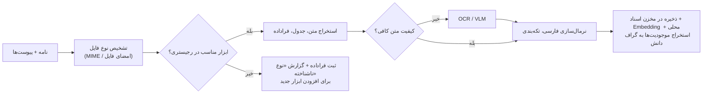

# پیوست‌ها و انواع فایل (Document Ingestion)

نامه‌های دبیرخانه پیوست‌های متنوعی دارند و دستیار باید **محتوای همه آن‌ها** را بخواند، تحلیل کند و به دانش خود اضافه کند. خواندن هر نوع فایل یک **مهارت/ابزار (Skill/Tool)** مستقل در رجیستری ابزارهاست تا با پیدا شدن نوع فایل جدید، بدون تغییر هسته سیستم، ابزار تازه اضافه شود.

## انواع فایل‌های شناخته‌شده

| نوع | نمونه | چالش | ابزار پیشنهادی (متن‌باز/داخلی) |
|---|---|---|---|
| Word | `.docx`، `.doc` | جدول‌ها، متن راست‌به‌چپ، نسخه قدیمی `.doc` | Docling یا python-docx؛ تبدیل `.doc` با LibreOffice (headless)؛ Apache Tika به‌عنوان پشتیبان |
| Excel | `.xlsx`، `.xls`، `.csv` | داده جدولی؛ نباید فقط متن شود | pandas / openpyxl؛ نگهداری ساختار جدول برای پرس‌وجو، نه فقط Embedding |
| PDF متنی فارسی | نامه و گزارش تایپ‌شده | ترتیب حروف راست‌به‌چپ، فونت‌های فارسی با نگاشت نادرست کاراکتر، «ی/ک» عربی | PyMuPDF / pdfplumber + نرمال‌سازی فارسی (مثلاً Hazm)؛ اگر متن استخراجی خراب بود، مسیر OCR |
| PDF متنی انگلیسی | کاتالوگ، استاندارد، مکاتبه خارجی | — | PyMuPDF / Docling |
| PDF اسکن‌شده فارسی | تصویر نامه‌های کاغذی که PDF شده‌اند | فقط تصویر است؛ نیاز به OCR فارسی؛ مهر، امضا، دست‌خط، کیفیت پایین اسکن | OCR فارسی: Tesseract (`fas`)، PaddleOCR، Surya، یا مدل بینایی-زبانی (VLM) محلی؛ **باید روی نمونه واقعی نامه‌های سازمان مقایسه شود** |
| تصویر | `.jpg`، `.png`، `.tif` | مانند اسکن | همان مسیر OCR / VLM |
| فایل فشرده | `.rar`، `.zip`، `.7z` | فایل‌های تو در تو، رمزدار | 7-Zip / unrar / libarchive؛ باز کردن **بازگشتی** و ارسال هر فایل به ابزار مناسب؛ محدودیت حجم و عمق (محافظت در برابر Zip bomb) |
| نقشه مهندسی AutoCAD | `.dwg`، `.dxf` | فرمت بسته DWG | تبدیل DWG به DXF با ODA File Converter (رایگان، مجوز اختصاصی) یا LibreDWG؛ استخراج متن، جدول مشخصات (Title block)، لایه‌ها و Attributeها با ezdxf؛ رندر تصویری برای تحلیل بصری |
| سایر فایل‌های نرم‌افزار مهندسی | فرمت‌های خاص نرم‌افزارهای تخصصی | ابزار عمومی ندارند | در ابتدا فقط ثبت فراداده (نام، نوع، حجم، نامه مرتبط)؛ افزودن ابزار اختصاصی هنگام نیاز |

## خط لوله پردازش پیوست

## الزامات

- **قابل گسترش:** هر نوع فایل یک افزونه با قرارداد ورودی/خروجی مشخص؛ افزودن ابزار جدید بر اساس نیازسنجی‌های بعدی بدون تغییر هسته.
- **حفظ منبع:** هر تکه متن به نامه، پیوست، صفحه و (در صورت امکان) مختصات روی صفحه ارجاع دارد تا پیشنهادهای دستیار قابل راستی‌آزمایی باشد.
- **کنترل کیفیت:** امتیاز اطمینان OCR ذخیره شود؛ متن کم‌کیفیت برای بازبینی علامت بخورد.
- **امنیت:** پردازش فایل‌ها در محیط ایزوله (Sandbox)؛ اسکن ضدبدافزار پیش از باز کردن؛ همه پردازش‌ها **داخل سازمان** ([نگهداری داده](../architecture/data-residency.md)).
- **پردازش شبانه:** پیوست‌های روز در Batch شبانه پردازش شوند؛ پیوست‌های فوری بلافاصله.

## منابع

- [ezdxf: ODA File Converter add-on](https://ezdxf.readthedocs.io/en/stable/addons/odafc.html)
- [GNU LibreDWG](https://www.gnu.org/software/libredwg/)
- [Persian Pixel: synthetic OCR dataset for Persian](https://huggingface.co/papers/2607.20385.md)
- [Best open source OCR tools 2026](https://unstract.com/blog/best-opensource-ocr-tools/)
